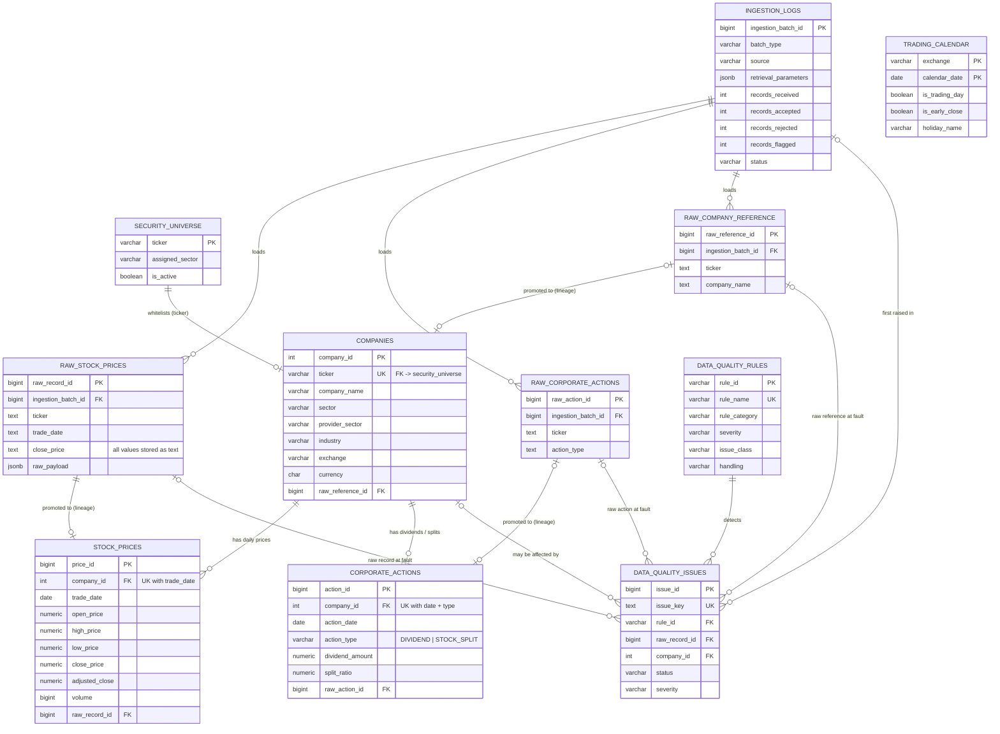

# EquityIQ — Entity Relationship Diagram

Rendered automatically by GitHub (Mermaid). Notation: `||--o{` = "exactly one to zero-or-many".
`PK` primary key, `FK` foreign key, `UK` unique key.

## Reading the cardinalities

| Relationship | Meaning |
|---|---|
| companies 1 — many stock_prices | One company has many daily prices; each price belongs to exactly one company. `(company_id, trade_date)` is unique, so at most one price per company per day. |
| raw_stock_prices 1 — 0..1 stock_prices | A raw row is promoted at most once. A quarantined or duplicate raw row is never promoted (0). Every validated price points back to exactly one raw row. |
| data_quality_rules 1 — many issues | Each issue is raised by exactly one rule. |
| raw records 0..1 — many issues | One raw row can fail several rules. An issue about a *missing* trading session has no raw row, so the link is optional. |
| security_universe 1 — 0..1 companies | A ticker must be in the universe before it can become a production company. |

`ref.trading_calendar` has no foreign keys: it is joined by date (and exchange) in validation queries rather than enforced as a constraint.
